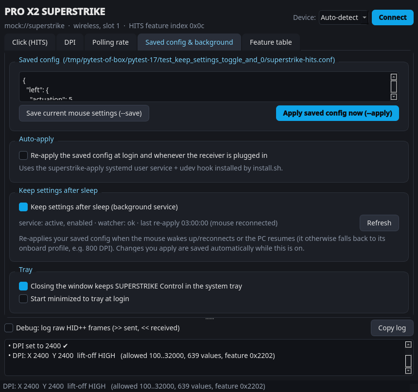

# SUPERSTRIKE Control for Linux (GUI fork) — v1.0.1

A dark **GUI + system-tray app** for the **Logitech G PRO X2 / X3 SUPERSTRIKE** on Linux: click **actuation**,
**click haptics**, **rapid trigger**, **DPI** and **polling rate (up to 8000 Hz)**, plus a background service
as a safety net after the mouse sleeps. DPI and polling rate are written into the mouse's
**onboard profile**, so they survive sleep the same way G HUB does. Works on **Arch / CachyOS** and **NixOS**.

> This is a fork of [**kazehana99k/Logitech-PRO-X2-SUPERSTRIKE-Linux-haptics-actuation-control-**](https://github.com/kazehana99k/Logitech-PRO-X2-SUPERSTRIKE-Linux-haptics-actuation-control-).
> All the HID++ reverse-engineering is kazehana99k's work. This fork adds the GUI, tray, DPI/polling-rate control,
> the keep-settings service, and Arch + NixOS packaging. **Coded with Grok**, with [**SHAHEII**](https://github.com/SHAHEII)
> as contributor and maintainer. See [Credits](#credits--contributors).

> **Testing status:** HITS (actuation/haptics/rapid trigger) uses the original, hardware-tested protocol. The **X3**
> support, **DPI**, **polling rate**, the **keep-settings-after-sleep service** and the **tray** are new and
> **lightly tested on real hardware** (mostly with a simulated mouse in the test-suite). Please open an issue with
> `superstrike-gui --diagnose` output if something doesn't work.



## Installation

### A) Arch Linux / CachyOS / Manjaro / EndeavourOS

1. Get the code:
   ```bash
   git clone -b gui https://github.com/SHAHEII/Logitech-pro-X2-and-X3-control-gui.git superstrike
   cd superstrike
   ```
2. Install (asks for your sudo password once, for `pacman -S python pyside6` and the udev rules):
   ```bash
   ./install.sh
   ```
   This installs into your home folder: the app (`~/.local/share/superstrike-hits`), the commands
   `superstrike-gui`, `superstrike-hits` and `superstrike-watch` (`~/.local/bin`), the app-menu entry
   *SUPERSTRIKE Control*, the udev rules (so no root is needed for the mouse) and two systemd **user** services.
3. **Unplug and replug the receiver/dongle once** (so the new udev permission applies).
4. Open **SUPERSTRIKE Control** from the app menu (or run `~/.local/bin/superstrike-gui`).
5. Set your DPI / polling rate / click settings. DPI and polling rate are written into the mouse's
   onboard profile, so they stay after sleep. Then, on the **Saved config & background** tab:
   * optional: tick **Keep settings after sleep (background service)**. This is a safety net: it
     re-applies HITS, and DPI/rate if they ever drifted, after idle / reconnect / resume;
   * optional: **Start minimized to tray at login**. *Closing the window keeps it in the tray* is on by default
     (use **Quit** in the tray menu to really exit).
6. Check that the service is running:
   ```bash
   systemctl --user status superstrike-watch.service
   journalctl --user -u superstrike-watch -f      # move the mouse after it slept: "re-applied saved settings"
   ```

**Update:** `git pull && ./install.sh`. **Uninstall:** `./install.sh --uninstall` (keeps `~/.config/superstrike-hits.conf`).
**Menu entry does nothing?** Run `~/.local/bin/superstrike-gui --diagnose` and look at `~/.cache/superstrike/gui.log`.
`~/.local/bin` not in your PATH (only matters for typing commands)? fish: `fish_add_path ~/.local/bin`.

### B) NixOS (flake)

1. Add the flake to your system flake (`/etc/nixos/flake.nix`):
   ```nix
   {
     inputs = {
       nixpkgs.url = "github:NixOS/nixpkgs/nixos-unstable";
       superstrike = {
         url = "github:SHAHEII/Logitech-pro-X2-and-X3-control-gui/gui";
         inputs.nixpkgs.follows = "nixpkgs";
       };
     };

     outputs = { nixpkgs, superstrike, ... }: {
       nixosConfigurations.my-pc = nixpkgs.lib.nixosSystem {   # use your hostname
         system = "x86_64-linux";
         modules = [
           ./configuration.nix
           superstrike.nixosModules.default
         ];
       };
     };
   }
   ```
2. Turn it on in `configuration.nix`:
   ```nix
   programs.superstrike = {
     enable = true;              # package + app-menu entry + udev rules (no root needed)
     watcher.enable = true;      # install the keep-settings-after-sleep user service (default)
     watcher.autoStart = false;  # true = start it for every user at login; false = toggle it in the GUI
     trayAtLogin = false;        # true = start the GUI minimized to the tray at login
   };
   ```
3. Rebuild, then replug the receiver once:
   ```bash
   sudo nixos-rebuild switch --flake /etc/nixos#my-pc
   ```
4. Open **SUPERSTRIKE Control** from the app menu, set things up, and tick **Keep settings after sleep** (or set
   `watcher.autoStart = true`). Check it with `systemctl --user status superstrike-watch.service`.

| Option | Default | What it does |
|---|---|---|
| `programs.superstrike.enable` | `false` | installs `superstrike-gui`, `superstrike-hits`, `superstrike-watch`, the menu entry and icon |
| `programs.superstrike.package` | this flake's package | package to use |
| `programs.superstrike.udevRules` | `true` | udev rules: `uaccess` on the Logitech hidraw nodes + auto-apply hook on plug-in |
| `programs.superstrike.watcher.enable` | `true` | ships `superstrike-watch.service` / `superstrike-apply.service` as systemd user units |
| `programs.superstrike.watcher.autoStart` | `false` | `wantedBy = graphical-session.target` for every user (the GUI toggle then can't turn it off) |
| `programs.superstrike.trayAtLogin` | `false` | system-wide XDG autostart of `superstrike-gui --tray` |

**NixOS without flakes** (`configuration.nix`):
```nix
{
  imports = [
    "${builtins.fetchTarball "https://github.com/SHAHEII/Logitech-pro-X2-and-X3-control-gui/archive/gui.tar.gz"}/nix/nixos.nix"
  ];
  programs.superstrike.enable = true;
}
```

**Just try it** (any distro with Nix, no install): `nix run github:SHAHEII/Logitech-pro-X2-and-X3-control-gui/gui`
(you still need the udev rule or root to access the mouse). Without a mouse: `nix run ... -- --mock`.

The flake also has `packages.<system>.default`, `overlays.default` (adds `pkgs.superstrike`) and `nix flake check`,
which runs the whole test-suite and evaluates the module.

### Other distros

Copy the files and the udev rule by hand: you need Python 3 + PySide6, `42-logitech-superstrike.rules` in
`/etc/udev/rules.d/`, and then run `python3 superstrike-gui.py`. The original CLI-only steps are below.

---

## Original project README (kazehana99k)

### superstrike-hits-linux

Control the **Logitech G PRO X2 SUPERSTRIKE** click-haptics and actuation points
on **Linux**, without G HUB.

The PRO X2 SUPERSTRIKE uses Logitech's **HITS** (Haptic Inductive Trigger System):
inductive analog main switches + a vibration motor that simulates the "click", with
**6 click-haptics levels** and **10 actuation-point levels**. On Windows these are set
in G HUB. On Linux there was **no way to change them** — the mouse is stuck on whatever
the onboard profile last had.

This project reverse-engineers the relevant HID++ feature (**`0x1B0C`**, not present in
libratbag/Solaar) and gives you a small, dependency-free CLI to read and set those values.
As of writing, neither **Solaar** nor **libratbag** supports this device's HITS settings.

## Features

- Read / set **click-haptics** (1–6) and **actuation point** (1–10), per button.
- Pure Python standard library, talks to `/dev/hidraw` directly. No daemon, no deps.
- **Auto-detects** the receiver's HID++ control interface (FF00 usage page) — no need to
  guess the right `/dev/hidrawN`.
- Optional **persistence**: save your levels and re-apply automatically on connect/boot.

## Requirements

- A Logitech **LIGHTSPEED receiver** (`046d:c54d`) with the SUPERSTRIKE paired.
  (Kernel `hid-logitech-dj` already exposes it; wired/direct should also work.)
- Python 3.

## Install (original CLI-only method)

```bash
git clone https://github.com/kazehana99k/Logitech-PRO-X2-SUPERSTRIKE-Linux-haptics-actuation-control-.git
cd Logitech-PRO-X2-SUPERSTRIKE-Linux-haptics-actuation-control-
chmod +x superstrike-hits.py

# non-root access (recommended): install the udev rule
sudo cp 42-logitech-superstrike.rules /etc/udev/rules.d/
sudo udevadm control --reload && sudo udevadm trigger
# then re-plug the receiver
```

## Usage

```bash
./superstrike-hits.py --get               # read current per-button settings
./superstrike-hits.py --haptics 4         # set click-haptics to level 4 (both buttons)
./superstrike-hits.py --actuation 7       # set actuation point to level 7
./superstrike-hits.py --haptics 6 --left  # left button only
./superstrike-hits.py --haptics 3 --actuation 8 --save   # set + remember as default
```

### Persistence (re-apply on every connect)

`--save` writes your levels to `~/.config/superstrike-hits.conf`; `--apply` reads and
applies them. Wire `--apply` to a udev/systemd hook so settings survive reboots and the
onboard profile being changed by Windows/G HUB. (See the repo wiki / issues for a sample
systemd unit.)

## GUI details (fork addition)

This fork adds **`superstrike-gui.py`**, a dark PySide6 window built on the functions in
`superstrike-hits.py`, so it behaves exactly like the CLI:

| Tab | What you can do |
|---|---|
| **Click (HITS)** | per-button **actuation** (1–10), **click haptics** (1–6, 1 = off), **rapid trigger** (1–5); link both buttons; defaults; read back; apply. Advanced: write raw bytes (`--raw-actuation` / `--raw-haptics`), checked against the device max and the multiple-of-4 rule |
| **Polling rate** | current rate and link type, one-click presets for every rate the mouse reports (up to 8000 Hz), and a custom number box capped at 8000 that snaps to the nearest supported rate, shown as "snapped 3000 → 2000" |
| **DPI** | current DPI, allowed range read from the mouse, X / Y / lift-off distance, presets 400–6400, values snapped to the mouse's steps |
| **Saved config & background** | `--save` / `--apply` with one click, view the saved file, auto-apply on plug-in/login, **Keep settings after sleep (background service)** with live status, tray options |
| **Feature table** | `--dump-features` as a table (0x1B0C highlighted) |

Also: device picker (`--device`), a log panel, status and error messages, and a **system tray icon**. Mouse I/O runs in a background thread, so the window never freezes.

### Install

See [Installation](#installation) at the top (Arch/CachyOS and NixOS). Try the GUI without a mouse:
`python3 superstrike-gui.py --mock`.

### "SUPERSTRIKE Control" in the app menu does nothing?

Cause (fixed): the menu entry used `Exec=superstrike-gui`, which only works if `~/.local/bin` is on the *session* PATH.
KDE Plasma's menu doesn't read your fish/bash config, so the launch failed silently. Now:

* `install.sh` writes the menu entry with an **absolute** `Exec=/home/<you>/.local/bin/superstrike-gui` (+ `TryExec`),
  checks it with `desktop-file-validate` (if `desktop-file-utils` is installed) and refreshes the KDE menu cache.
* The `~/.local/bin/superstrike-gui` wrapper calls `/usr/bin/python3` directly, logs every start to
  **`~/.cache/superstrike/gui.log`**, and if the app exits with an error you get a desktop notification
  (`notify-send`, falling back to a `kdialog`/`zenity` dialog) with the last log lines.
* `superstrike-gui --diagnose` prints python/PySide6, display variables, the desktop + autostart files, `hidraw`
  permissions, udev rules, both services, the saved config and a live read of the mouse. Paste it in an issue.

Just re-run `./install.sh` after updating.

### DPI / polling rate persistence (onboard profile) and "Keep settings after sleep"

DPI and polling rate are persisted by a **read-modify-write of the active format-8 onboard profile**
(HID++ `0x8100`, CRC-16/CCITT-FALSE), then staying in onboard mode — the same approach G HUB uses.
That keeps the SUPERSTRIKE pointer working and survives sleep. Only format 8 is written; unknown
layouts fall back to host mode. The rest of the 255-byte sector (buttons / macros) is copied unchanged.

`superstrike-watch.service` is a **safety net**, not the persistence design. Tick **Keep settings after sleep
(background service)** on the *Saved config & background* tab to enable it (a systemd `--user` service, ~0 % CPU).
It re-applies HITS, and DPI/rate if they drifted from the saved config, when:

* the dongle reports the mouse **reconnected**: HID++ 1.0 `0x41` connect notification or the HID++ 2.0 `0x1D4B`
  "wireless device status: reconfiguration needed" event (the same signals Solaar uses);
* a receiver `hidraw` node **appears** again (plug-in, USB reset after resume); a node that disappears is dropped and
  re-scanned every 3 s. Writes always **scan for the HID++ (FF00) node** rather than opening the listener path,
  which after USB re-enumeration can be a different hidraw device;
* the **PC resumes** from suspend (detected by `CLOCK_BOOTTIME` jumping ahead of `CLOCK_MONOTONIC`);
* a light safety-net check (every 30 s) finds live DPI/rate different from the saved config.

It just sleeps in `select()` on the hidraw node (no busy polling) and only opens it read-only to listen. All writes,
from the service, the GUI and the tray, take one shared lock (`$XDG_RUNTIME_DIR/superstrike.lock`), so they never
interleave. While the service is on, every change you apply in the GUI/tray is saved automatically so it restores the
latest values. If you switch to onboard while it's on, a later re-apply is an onboard profile write, not a host switch.

```bash
systemctl --user status superstrike-watch.service     # running?
journalctl --user -u superstrike-watch -f              # watch it re-apply when you wake the mouse
superstrike-watch --status                             # last re-apply / error (JSON)
superstrike-watch --once                               # apply the saved config once, now
```

### System tray

The app puts an icon in the tray (KDE: next to the clock). Right-click it for:

* **Open SUPERSTRIKE Control**, the current **DPI · polling rate** (read-only line),
* **DPI** presets (400 – 6400) and **Polling rate** presets (the rates the mouse reports, up to 8000 Hz),
* **Re-apply saved settings**, **Quit**.

Left-click toggles the window. Options in *Saved config & background*:

* *Closing the window keeps SUPERSTRIKE Control in the system tray* (on by default; use **Quit** in the tray menu to exit).
* *Start minimized to tray at login*: writes `~/.config/autostart/superstrike-gui.desktop` with `--tray`.

Only one copy runs: launching it again (menu, `superstrike-gui`) shows the existing window. The tray never listens to
the mouse itself; the background service does that, and both use the shared lock.

Try the GUI without a mouse: `python3 superstrike-gui.py --mock`.

### DPI says "hid++ error 5 (LOGITECH_INTERNAL) … fn=6"?

That's the mouse refusing a **live** DPI/rate write because it's in **onboard-profile mode**. This was seen on
a real SUPERSTRIKE. The default fix is **not** to switch to host mode: host mode can freeze the SUPERSTRIKE
pointer (the control channel stays up, so the app can look successful while the cursor is dead). Instead the
app writes the format-8 onboard profile and stays onboard.

* GUI: *DPI* tab → "Write DPI and polling rate into the onboard profile" (on by default). Untick it for a
  live HID++ write only (that still hits error 5 while onboard). The *Switch to host mode* /
  *Back to onboard profile* buttons are still there; host mode can freeze the pointer.
* CLI: `--dpi` / `--rate` write the onboard profile (`--no-host-switch` is a live HID++ write only).
  `--onboard status|host|onboard` shows or sets the mode.
* Host mode is only used if the profile layout is not format 8 (or a profile write fails), or if you ask
  for it explicitly. It is **lost when the mouse powers off** and can freeze the pointer.

Still failing? Turn on the GUI's *Debug: log raw HID++ frames* box, try again, press *Copy log* and send it,
or run `superstrike-hits --trace --dpi 1600 2> dpi-trace.txt`.

### Polling rate (up to 8000 Hz)

* `--rate 8000`, `--rate-list`. In the GUI, use the *Polling rate* tab. HID++ `0x8061` (extended report rate), falling back to `0x8060`.
* The mouse only runs at the **fixed rates it reports**. On the SUPERSTRIKE that's normally 125 / 250 / 500 / 1000 / 2000 / 4000 / 8000 Hz.
  There's no 400 Hz or 3000 Hz in the hardware. Any number you type (capped at 8000) is snapped to the nearest
  supported rate (a tie goes to the lower one), and only that rate is sent. Unsupported values are never sent.
* The current rate is read with a "wireless" link byte when the mouse is behind a receiver or dongle. Solaar PR #3352
  found that the X3 dongle otherwise answers for the wired link (it showed 1000 Hz while really at 8000).
* Like DPI, the rate is written into the onboard profile (see above). `--save` / auto-apply include `polling_hz`.
* 8000 Hz drains the battery much faster (Tom's Hardware: under 40 h on the X3, compared with 135 h at 1000 Hz).

### New CLI options in this fork

```bash
./superstrike-hits.py --rapid-trigger 1            # 1 = fastest reset .. 5
./superstrike-hits.py --dpi 1600                   # snapped to the nearest allowed value
./superstrike-hits.py --dpi 1600 --dpi-y 1200 --lod low
./superstrike-hits.py --dpi-list                   # every DPI the mouse accepts
./superstrike-hits.py --dump-features              # documented in PROTOCOL.md, now implemented
./superstrike-hits.py --onboard status             # onboard-profile vs host mode (host can freeze the pointer)
./superstrike-hits.py --trace --get                # print raw HID++ frames (for bug reports)
./superstrike-hits.py --raw-actuation 0x10 --raw-haptics 0x0c --left
```

Where these come from:
* **Rapid trigger** is the `x` byte: `level << 2`, with bit 0 a firmware flag that is kept. The `0x09` seen in
  PROTOCOL.md decodes to level 2 + flag. The encoding comes from Solaar (PR #3132 + fix #3207), which was tested on a real X2.
* **DPI** uses HID++ `0x2202` (extended adjustable DPI, present on the X2), with a fallback to `0x2201`. Both use Solaar's wire format.
* `--save` now also stores `rapid_trigger` and `dpi`. Old config files still apply.
* Bug fix: HID++ error replies are now recognised. Before, every failed call waited about 2.4 s for retries.

### PRO X3 SUPERSTRIKE?

The X3 uses a new dongle **046d:c54f** (mouse WPID 40BE). According to Solaar PR #3352 (tested on a real X3),
that dongle speaks HID++ 2.0 with the mouse at **device index 1**, and the same `0x1B0C` tuning works unchanged.
This tool tries index 1 first, on any Logitech hidraw node with the FF00 usage page. On SHAHEII's real X3
(CachyOS) it connected through the dongle in slot 1, with HITS at feature index 0x16 and DPI (`0x2202`, range
100–48000), and setting DPI worked once the host-mode fix was added. Polling-rate changes, the keep-settings service and the
tray are newer and have had little real-hardware testing so far. The fork adds c54f to the udev permission and
auto-apply rules.

## How it works

Full reverse-engineering notes and the exact HID++ protocol (feature `0x1B0C`, the
`[button][actuation][x][haptics]` record format, level↔byte mappings, and how it was
captured from G HUB) are in **[PROTOCOL.md](PROTOCOL.md)**.

## Status / TODO

- [x] `x` = rapid trigger (level<<2 | flag), exposed as `--rapid-trigger` (per Solaar's hardware-tested encoding).
- [ ] Upstream as a libratbag device entry and/or a Solaar feature plugin for `0x1B0C`.
- [x] Packaged systemd/udev auto-apply (`install.sh`, toggle in the GUI).

## Credits / Contributors

* **Original project and all HID++ reverse-engineering:** [**kazehana99k**](https://github.com/kazehana99k), in
  [kazehana99k/Logitech-PRO-X2-SUPERSTRIKE-Linux-haptics-actuation-control-](https://github.com/kazehana99k/Logitech-PRO-X2-SUPERSTRIKE-Linux-haptics-actuation-control-) (USBPcap differential capture of G HUB + on-device HID++ probing).
  This fork is based on that project and keeps its MIT licence and copyright.
* **GUI fork contributor and maintainer:** [**SHAHEII**](https://github.com/SHAHEII) (idea, requirements and testing on
  a real PRO X3 SUPERSTRIKE under CachyOS).
* **Coded with Grok:** the GUI, tray, DPI/polling-rate support, keep-settings service, Arch/NixOS packaging and
  tests were written with Grok (commits carry `Co-authored-by: Grok`).
* Protocol details for rapid trigger, DPI, report rate and the X3 dongle come from
  [Solaar](https://github.com/pwr-Solaar/Solaar) (PRs #3132, #3207, #3352).

Contributions / upstreaming welcome.

## Disclaimer

This is an independent, community project. It is **not affiliated with, authorized, or
endorsed by Logitech**. "Logitech", "G PRO", "PRO X2 SUPERSTRIKE", "LIGHTSPEED" and any
related names are trademarks of their respective owners and are used here only nominatively,
to describe hardware compatibility. The protocol was reverse-engineered for interoperability
with hardware the author owns; no Logitech software, firmware, or other copyrighted material
is included or redistributed. The software is provided "as is", without warranty of any kind —
use at your own risk, and you are responsible for complying with the laws and license terms
applicable to you.

## License

MIT, see [LICENSE](LICENSE). Copyright (c) 2026 kazehana99k (original project); fork changes are released under the same MIT licence.
